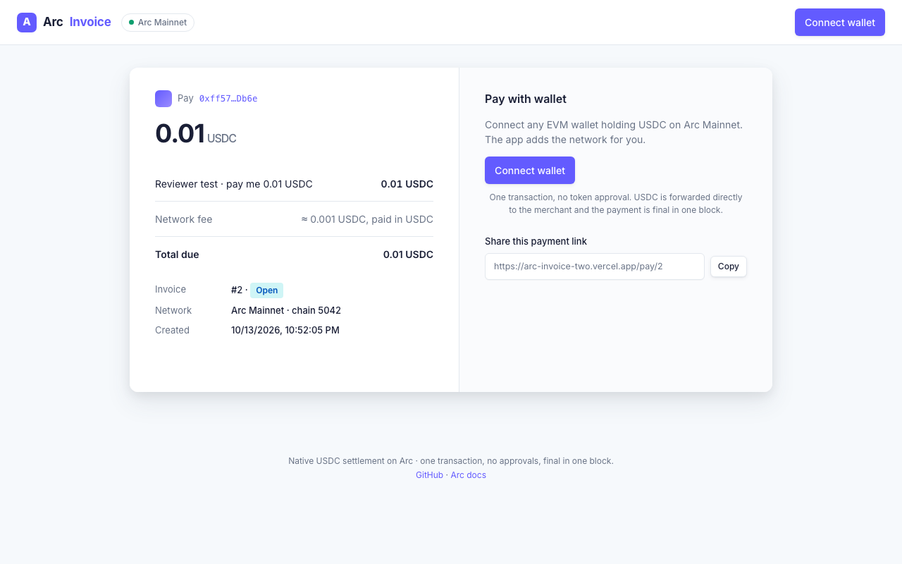
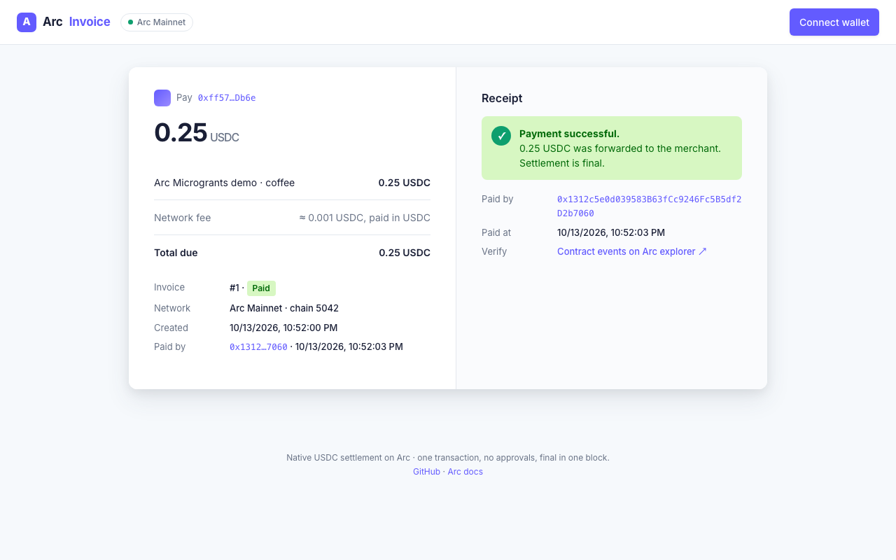
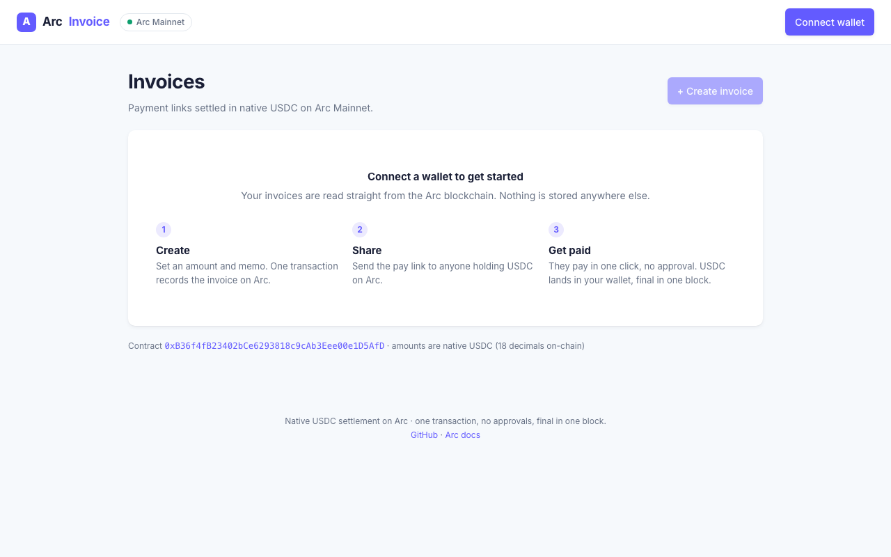

# ArcInvoice

**Payment links settled in native USDC on Arc.** A merchant creates an invoice, shares a link, and the payer settles it in a single transaction. No token approval, no second gas asset, final in one block.

- Live app: https://arc-invoice-two.vercel.app
- Network: Arc mainnet (chain ID 5042) · contract: [`0xB36f4fB23402bCe6293818c9cAb3Eee00e1D5AfD`](https://explorer.arc.io/address/0xB36f4fB23402bCe6293818c9cAb3Eee00e1D5AfD)
- Testnet deployment (chain ID 5042002): [`0xB36f4fB23402bCe6293818c9cAb3Eee00e1D5AfD`](https://explorer.testnet.arc.io/address/0xB36f4fB23402bCe6293818c9cAb3Eee00e1D5AfD)
- Built for [Arc Microgrants](https://dorahacks.io/hackathon/arc-microgrants) · [](https://github.com/kang5647/arc-invoice/actions/workflows/ci.yml)

## For reviewers: 60-second flow

1. **See a real mainnet payment.** Open https://arc-invoice-two.vercel.app/pay/1: invoice #1 was paid on Arc mainnet with 0.25 USDC. The receipt links to the payer and to the contract's events on the explorer.
2. **Pay one yourself.** Open https://arc-invoice-two.vercel.app/pay/2, connect a wallet holding a little USDC on Arc (the app adds the network), and click Pay. One transaction, no approval, about 0.011 USDC all in.
3. **Create your own.** Go to https://arc-invoice-two.vercel.app, click Create invoice, open the link it gives you.
4. **Verify on-chain.** Contract source is verified on [explorer.arc.io](https://explorer.arc.io/address/0xB36f4fB23402bCe6293818c9cAb3Eee00e1D5AfD?tab=contract). All mainnet transactions are listed in [docs/DEPLOYMENTS.md](docs/DEPLOYMENTS.md).

## Screenshots

| Checkout (open invoice) | Receipt (paid invoice) |
|---|---|
|  |  |



## What it does

1. **Create.** The merchant signs one transaction: `createInvoice(amount, expiresAt, memo)`. The invoice is stored on Arc and the app shows a shareable link `/pay/<id>`.
2. **Share.** Anyone with USDC on Arc can open the link. The page reads the invoice straight from the chain, no backend.
3. **Pay.** The payer clicks once. `pay(id)` is called with the invoice amount as `msg.value`. Because USDC *is* Arc's native token, the money and the record travel in the same transaction. The contract forwards the USDC to the merchant immediately and marks the invoice paid.

Every step emits an event, and native USDC moves also emit Arc's system `Transfer` log, so the receipt is fully verifiable on the explorer.

## Why Arc

| Arc property | What ArcInvoice gets from it |
|---|---|
| USDC is the gas token | A payer needs only USDC. No ETH, no approvals, one click. |
| Native value with 18 decimals and an ERC-20 view with 6 | The contract uses only the native path, avoiding the two-interface decimal trap entirely. |
| Deterministic one-block finality | The "Paid" state is final the moment the wallet confirms. |
| EIP-7708 native Transfer logs | Explorers show the USDC movement without the contract doing extra work. |
| 20 gwei base fee on an 18-decimal unit | A payment costs about 0.0013 USDC in gas. |

## Repository layout

```
contracts/            Foundry
  src/ArcInvoice.sol  single contract: createInvoice / pay / cancel + views
  test/ArcInvoice.t.sol  11 tests incl. reentrancy, forward failure, expiry, fuzz
  script/Deploy.s.sol
web/                  Next.js 16 + wagmi 3 + viem 2, no backend
  src/app/page.tsx         merchant dashboard: create + list + cancel
  src/app/pay/[id]/        public pay page with share link and receipt
  src/lib/config.ts        chain selection via NEXT_PUBLIC_ARC_NETWORK
```

Also: [`docs/DEPLOYMENTS.md`](docs/DEPLOYMENTS.md) (addresses, tx log), [`docs/dorahacks-submission.md`](docs/dorahacks-submission.md) (submission text), [`docs/ArcInvoice.standard-input.json`](docs/ArcInvoice.standard-input.json) (verification input), `.github/workflows/ci.yml` (forge tests + web build on every push).

Reads use the public Circle RPC and the contract's own index (`merchantInvoices`, `getInvoices`), which sidesteps Arc's 10,000-block `eth_getLogs` limit. Writes go through the connected injected wallet (MetaMask, Rabby, etc.).

## Contract

```solidity
function createInvoice(uint96 amount, uint64 expiresAt, string calldata memo) external returns (uint256 id);
function pay(uint256 id) external payable;          // msg.value must equal amount; forwards to merchant
function cancel(uint256 id) external;               // merchant only, while Open
function getInvoice(uint256 id) external view returns (Invoice memory);
function merchantInvoices(address) external view returns (uint256[] memory);
function getInvoices(uint256[] calldata ids) external view returns (Invoice[] memory);
```

Amounts are native units (18 decimals, `1 USDC == 1e18`). Checks-effects-interactions plus a reentrancy lock; the contract holds no balance between transactions.

## Run it yourself

```bash
# contracts
cd contracts && forge test -vv

# deploy (needs a wallet with a little USDC on Arc; PRIVATE_KEY in ../.env)
forge script script/Deploy.s.sol --rpc-url https://rpc.mainnet.arc.io --broadcast \
  --with-gas-price 20100000000 --priority-gas-price 1000000000
forge verify-contract 0xB36f4fB23402bCe6293818c9cAb3Eee00e1D5AfD src/ArcInvoice.sol:ArcInvoice --chain-id 5042 \
  --verifier blockscout --verifier-url https://explorer.arc.io/api/

# frontend
cd ../web && pnpm install
echo "NEXT_PUBLIC_ARC_NETWORK=mainnet\nNEXT_PUBLIC_CONTRACT_ADDRESS=0xB36f4fB23402bCe6293818c9cAb3Eee00e1D5AfD" > .env.local
pnpm dev
```

Arc wallet settings: RPC `https://rpc.mainnet.arc.io`, chain ID `5042`, symbol `USDC`, 18 decimals, explorer `https://explorer.arc.io`. The app offers to add the network when you connect.

## Reproduce an on-chain payment from the CLI

```bash
C=0xB36f4fB23402bCe6293818c9cAb3Eee00e1D5AfD; R=https://rpc.mainnet.arc.io
cast send $C "createInvoice(uint96,uint64,string)" 1000000000000000000 0 "Coffee" --private-key $MERCHANT_KEY -r $R --gas-price 20100000000 --priority-gas-price 1000000000
cast send $C "pay(uint256)" 1 --value 1000000000000000000 --private-key $PAYER_KEY -r $R --gas-price 20100000000 --priority-gas-price 1000000000
cast call $C "getInvoice(uint256)((address,uint96,uint64,uint64,uint8,address,uint64,string))" 1 -r $R
```

## Mainnet transactions

| Action | Transaction |
|---|---|
| Deploy `ArcInvoice` | [0xcd0670…b749](https://explorer.arc.io/tx/0xcd06708bb3ee5425bb4db086ee212efabd355891a12ff7a889f496f2be24b749) |
| Create invoice #1 (0.25 USDC, "Arc Microgrants demo · coffee") | [0x40c38e…7d28](https://explorer.arc.io/tx/0x40c38eceecd8c975467bbf39e2d300fe17e2087ef52ac44c74dd58d650657d28) |
| Pay invoice #1 from a second wallet | [0xac7ccc…f3e4](https://explorer.arc.io/tx/0xac7cccd2ad45ae362f385dc2808ac5c3fd260c19aa64b3879b27a5b8cf18f3e4) |
| Create invoice #2 (0.01 USDC, open for reviewers) | [0xf1965c…d27a](https://explorer.arc.io/tx/0xf1965c6a39b793d6708c626d1f8799ae5b5ef85e42eb445da393a9d6debfd27a) |

Total gas for all of the above: about 0.025 USDC.

## Where this goes

ArcInvoice is meant to become invoicing rails for Arc, not just a pay button. Invoices are the unit of B2B money movement, and Arc is the first chain where the invoice, the money and the gas are the same asset, which makes machine-to-machine billing practical.

1. **Agent settlement.** An invoice link doubles as an x402 payment challenge; agents settle with a signed EIP-3009 `receiveWithAuthorization` on Arc's USDC, so no agent needs gas or a UI.
2. **Hosted API and SDK.** Create invoices from a server, subscribe to receipts derived from contract events, embed the checkout anywhere.
3. **Batch and multi-currency.** Multicall3 payouts, EURC invoices through StableFX.

The contract is minimal and holds no funds between transactions, so each step is additive.

## License

MIT
